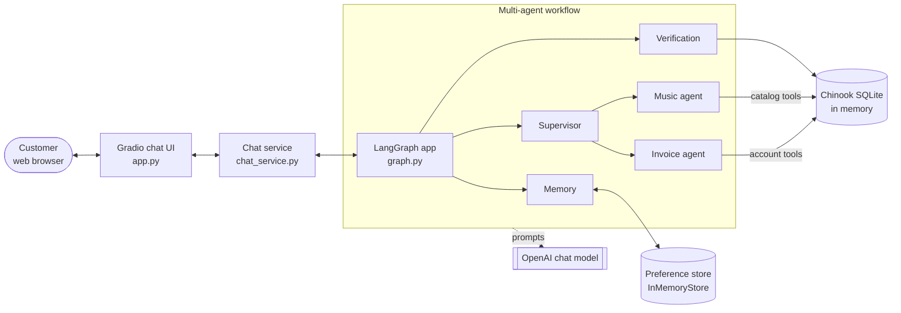
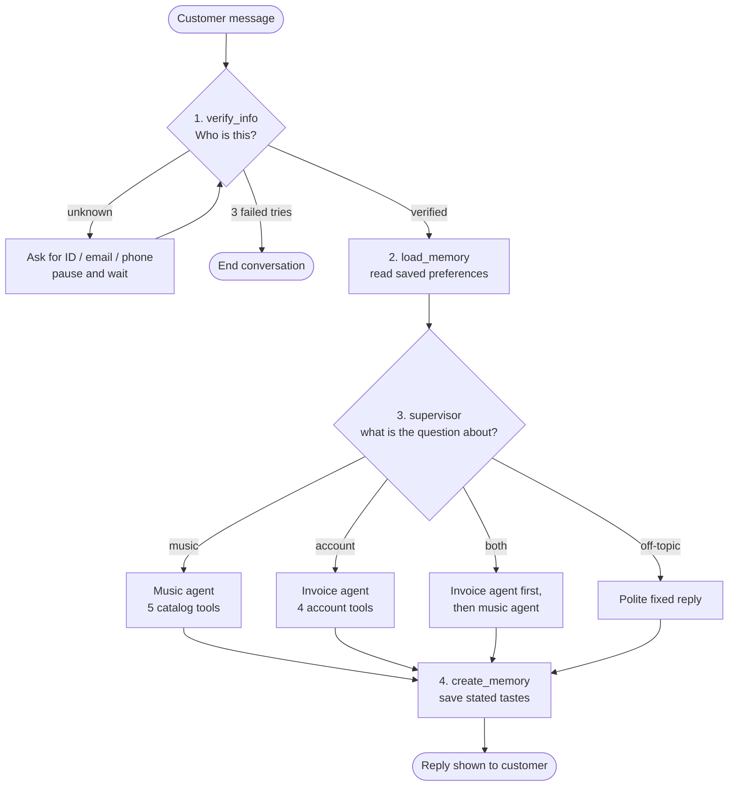

# Architecture Overview

**Audience:** For anyone who wants to learn multi-agent AI application.
**Level:** For details, see [TECHNICAL_SPECIFICATION.md](TECHNICAL_SPECIFICATION.md).

## What the app does

A customer chats with a support assistant for a digital music store. The assistant:

1. **Verifies** who the customer is (Customer ID, email or phone).
2. **Answers catalog questions** in plain English ("What AC/DC albums do you have?").
3. **Looks up the customer's own invoices and purchases** ("How much have I spent?").
4. **Remembers music tastes** ("I love jazz") and uses them next time.

## The big picture

**Three layers, from top to bottom:**

| Layer | What it is | Files |
|---|---|---|
| User interface | A web chat page | `app.py`, `chat_service.py` |
| Agents | A LangGraph workflow: verify, route, answer, remember | `graph.py`, `verification.py`, `supervisor.py`, `music_agent.py`, `invoice_agent.py`, `memory.py` |
| Data | Database tools and the sample Chinook database | `tools.py`, `database.py`, `DBSet/` |

## How one message flows through the graph

1. **Verify** - an LLM pulls the identifier out of the message, then a SQL query checks it. If it fails, the graph **pauses** (`interrupt()`) until the customer replies.
2. **Load memory** - saved preferences for this customer are read from the store.
3. **Supervisor** - classifies the request and hands it to the right specialist agent.
4. **Create memory** - any new music tastes the customer *stated* are saved.

## Key ideas to teach

| Concept | Where to see it |
|---|---|
| **Supervisor pattern** (one boss agent, several specialists) | `supervisor.py` |
| **ReAct agent** (think → call tool → read result → answer) | `music_agent.py` (built by hand), `invoice_agent.py` (prebuilt) |
| **Tool calling** (LLM uses Python functions to query the DB) | `tools.py` |
| **Human-in-the-loop** (pause the graph and wait for the user) | `verification.py` (`interrupt()`) |
| **Short-term memory** (the conversation) | `MemorySaver` checkpointer in `graph.py` |
| **Long-term memory** (preferences across conversations) | `InMemoryStore` in `memory.py` |
| **Structured output** (LLM returns a Pydantic object) | `UserInput`, `RoutePlan`, `UserProfile` |
| **Guardrails** (grounding, privacy, scope) | prompts in each agent; verified ID injected into tools |
