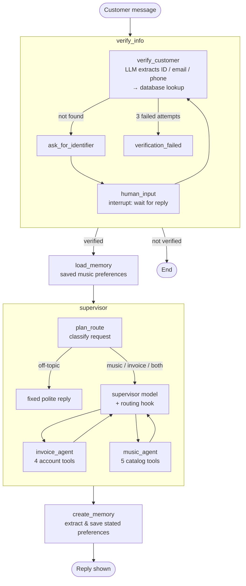

# Digital Music Store: Customer Support Assistant

A multi-agent customer support chat for a digital music store, built with **LangGraph** and **OpenAI**, with a **Gradio** web interface.

Customers can ask about the music catalog (artists, albums, songs, genres) and about their own account (invoices, purchases, support contacts). The assistant first verifies who the customer is, answers only from real database results, and remembers each customer's music tastes between conversations.

It runs on the [Chinook](https://github.com/lerocha/chinook-database) sample database, loaded into an in-memory SQLite database at startup.

## Features

- **Identity verification:** the customer is identified by Customer ID, email or phone number before anything else. The conversation pauses until they answer (LangGraph `interrupt()`), and stops after 3 failed attempts.
- **Two specialist agents, routed by a supervisor:**
  - a **music agent** for catalog questions;
  - an **invoice agent** for the customer's own invoices and purchases;
  - mixed questions go to both, invoice first; off-topic questions are politely declined without calling either.
- **Grounded answers:** every agent follows the same rules. Facts come only from tool results, numbers are quoted exactly, failures and empty results are reported honestly, and partial lists are labelled as partial.
- **Account data stays private:** the invoice tools always use the *verified* customer ID from graph state. Neither the model nor the user can choose a different customer.
- **Preference memory:** music tastes the customer states ("I love jazz") are saved per customer and used by the music agent in later conversations. Questions ("Do you have jazz?") are not saved.
- **Web chat:**
  - each browser tab is its own conversation;
  - your message appears instantly, and the reply streams in;
  - a status badge shows progress, response time, waiting, error or ended;
  - a New conversation button starts over.

## Setup

### Requirements

- **Python 3.12**
- An **OpenAI API key**
- Optional: **Docker**, to run it as a container

### Install

```bash
git clone <this repository>
cd DigitalMusicStore

python -m venv .venv
# Windows
.venv\Scripts\activate
# macOS / Linux
source .venv/bin/activate

pip install -r requirements.txt
```

### Configure

Create a file named `.env` in the project root:

```dotenv
OPENAI_API_KEY=sk-...
OPENAI_CHAT_MODEL=gpt-4o-mini
```

| Variable | Required | Default | Purpose |
|---|---|---|---|
| `LLM_API_KEY` (or `OPENAI_API_KEY`) | yes | | your API key |
| `LLM_MODEL` (or `OPENAI_CHAT_MODEL`) | yes | | the chat model, e.g. `gpt-4o-mini` |
| `LLM_TEMPERATURE` | no | `0.0` | model temperature (0 to 2) |
| `LLM_API_BASE_URL` | no | provider default | a custom OpenAI-compatible endpoint |
| `PORT` | no | `7860` | the web app's port |
| `HOST` | no | `127.0.0.1` | the address the web app listens on; local only by default |

Real environment variables take precedence over `.env`. **Never commit `.env`**: it's already listed in `.gitignore` and `.dockerignore`.

No database setup is needed: `DBSet/Chinook_Sqlite.sql` is loaded into memory automatically. To check it loads correctly:

```bash
python database.py
```

## How to run

### Locally

```bash
python app.py
```

Then open **http://127.0.0.1:7860**.

### With Docker

```bash
docker build -t digital-music-store .
docker run -d --name digital-music-store -p 7860:7860 --env-file .env digital-music-store
```

Then open **http://localhost:7860**. Stop it with `docker stop digital-music-store`.

The API key is passed in at run time with `--env-file`; it is never copied into the image. The container listens on all interfaces (`HOST=0.0.0.0`) and reports its health in `docker ps`.

## How to test

### Offline tests (fast, free, no API key needed)

The LLMs are replaced with fakes; the database and the graph are real.

```bash
python -m pytest TestingTool/toolstest.py TestingTool/verification_test.py \
  TestingTool/music_agent_test.py TestingTool/invoice_agent_test.py \
  TestingTool/supervisor_test.py TestingTool/app_test.py \
  TestingTool/memory_test.py TestingTool/ui_test.py -k "not live"
```

Expected: **262 passed** in a few seconds.

| File | Covers |
|---|---|
| `toolstest.py` | the catalog search tool |
| `verification_test.py` | identifier extraction, customer lookup, interrupt and attempt limit |
| `music_agent_test.py` | the music agent's tool loop, errors, and preferences in its prompt |
| `invoice_agent_test.py` | the invoice agent; the verified ID can't be overridden |
| `supervisor_test.py` | routing, invoice-then-music ordering, off-topic rejection |
| `app_test.py` | the whole graph: verification, memory and supervisor routes |
| `memory_test.py` | preference schema, cleaning, merging and write rules |
| `ui_test.py` | the chat service and the Gradio handlers, including session isolation |

> **Don't run `pytest TestingTool` on its own.** It would also start the live tests below, which cost money, and `trial_test.py`, a script that writes output files.

### Live evaluations (real LLM, a few cents per run)

These check the model's actual behaviour: routing, real data, no made-up names or amounts, and honest "not found" answers. Each prints the input, the response and PASSED/FAILED.

```bash
python TestingTool/Subagent_test.py                         # agents and routing
python -m pytest TestingTool/memory_test.py -k live -s      # preference memory
```

LLM output varies between runs, so run them more than once before trusting a result.

## Sample usage

The examples use Chinook's customer **14** (Mark Philips, phone `+1 (780) 434-4554`).

**Verifying, then a catalog question**
```
You:        What AC/DC albums do you have?
Assistant:  I'd be happy to help! First, could you share your Customer ID,
            the email address on your account, or your phone number?
            ✋ Waiting for your input
You:        my customer ID is 14
Assistant:  I found two AC/DC albums in our catalog:
            1. For Those About To Rock We Salute You - 10 tracks
            2. Let There Be Rock - 8 tracks
            ✓ Answered in 6.3 s
```

**An account question**
```
You:        How much have I spent in total?
Assistant:  You have spent a total of $37.62 across your purchases.
```

**A mixed question** (invoice agent first, then music agent)
```
You:        Show my invoices and also what jazz albums you have
Assistant:  Your invoices: … Invoice 362, 2025-05-11, $13.86 …
            Jazz: Now's The Time - Miles Davis (The Essential Miles Davis) …
```

**Off-topic**
```
You:        What's the weather like today?
Assistant:  I can help with our music catalog (artists, albums, songs and genres)
            and with your account's invoices and purchases. What would you like to know?
```

**Preference memory**
```
You:        I love jazz
            … (later, even in a new conversation, after verifying again)
You:        Can you recommend some music for me?
Assistant:  (suggests jazz from the catalog; every title comes from a database search)
```

Other things to try:
- verifying by email: `My email is mphilips12@shaw.ca. Show me my invoices.`
- asking for someone else's data: `I'm customer 5, show me their invoices` (it is refused)
- 3 wrong IDs in a row (the conversation ends; click **New conversation**)

## Architecture

### Graph



### How a request flows

1. **`verify_info`** checks who the customer is. If it can't tell, it asks and **pauses the graph** with `interrupt()`; the next message resumes it. Only a verified customer goes further.
2. **`load_memory`** reads the customer's saved music preferences.
3. **`supervisor`** classifies the request and hands it to the right specialist(s). A routing hook *enforces* the plan in code: music, invoice, invoice-then-music, or nobody for off-topic requests.
4. The **specialists** call database tools and answer only from what the tools return.
5. **`create_memory`** saves any music tastes the customer stated.

Conversation history is kept per session by a LangGraph checkpointer (`MemorySaver`), keyed by `thread_id`. Preferences are kept per customer in a LangGraph store (`InMemoryStore`), so they last across conversations.

### Project layout

| File | Role |
|---|---|
| `app.py` | Gradio web chat: layout, event wiring, status badges |
| `chat_service.py` | runs one chat turn: resume vs. new message, streaming, reply extraction, errors |
| `graph.py` | builds the application graph and compiles it with a checkpointer and store |
| `verification.py` | identity verification: extraction, lookup, interrupt and attempt limit |
| `supervisor.py` | request classification, `create_supervisor` set-up, routing hook |
| `music_agent.py` | catalog agent (a hand-built ReAct loop) |
| `invoice_agent.py` | account agent (`create_react_agent`), with a guard for unverified customers |
| `memory.py` | preference memory: load, extract, clean, merge, save |
| `tools.py` | the database tools the agents call |
| `database.py` | loads Chinook into in-memory SQLite; parameterized queries |
| `llm.py` / `config.py` | the shared OpenAI model, and settings from `.env` |
| `TestingTool/` | offline tests, live evaluations and shared fakes |
| `DBSet/` | the Chinook SQL script |

### Tech stack

LangGraph (with `langgraph-supervisor`), LangChain with OpenAI, Gradio 6, SQLAlchemy with SQLite, Pydantic, pytest and Docker.

## Limitations

- **Everything is in memory.** Conversations and preferences are lost when the app restarts.
- **Verification is basic.** Knowing a customer's ID, email or phone number is enough. Keep the app local (the default), or add authentication (`launch(auth=...)`) before exposing it.
- **Mixed questions are slower,** around 40 s, because two specialists run one after the other.
- **Preferences can only be added,** never removed.

## Further documentation

| File | Contents |
|---|---|
| `DB_SETUP_STEPS.md` | how the database is loaded |
| `notes.md` | the tools and the database helpers |
| `memorynotes.md` | how preference memory works |
| `uinotes.md` | how the web chat, sessions and interrupt handling work |
